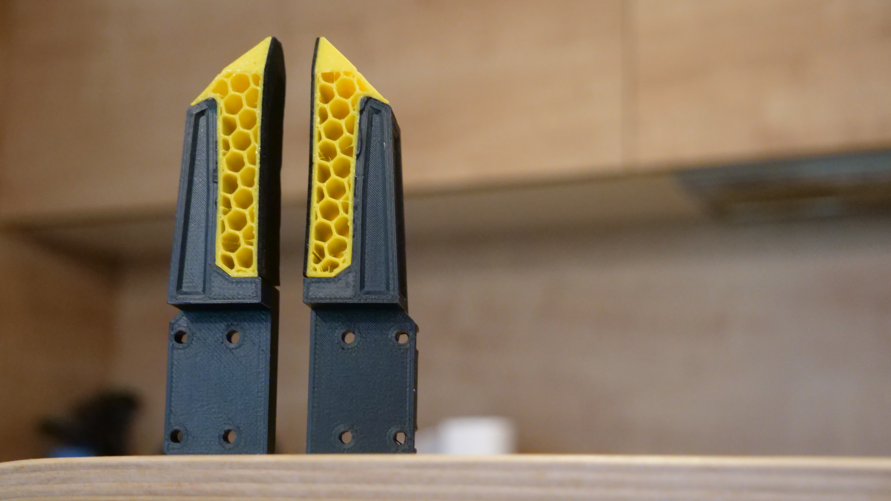
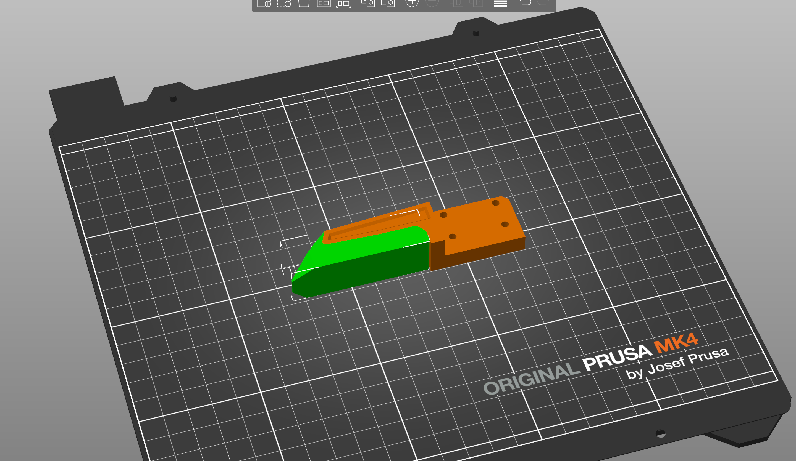
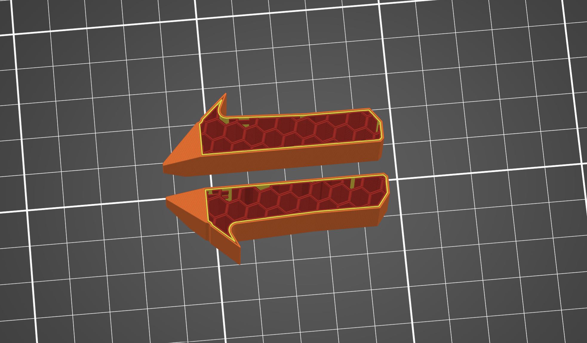
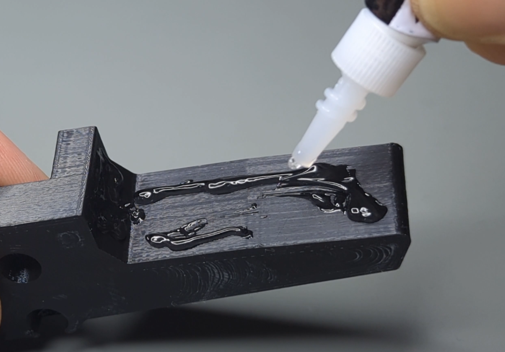
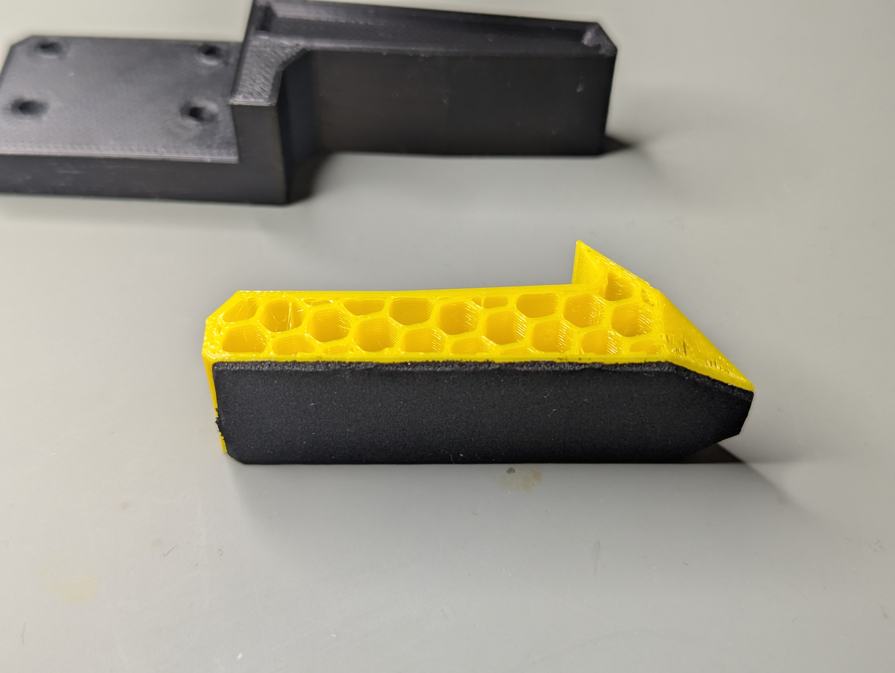
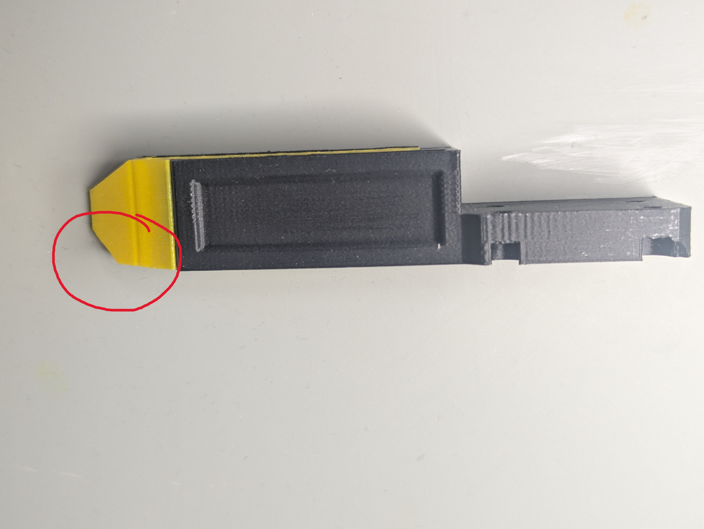

# Building the Gripper jaws

There are two ways to build the gripper jaws:

- **[TPU Gripper Jaws](#tpu-gripper-jaws)** — a rigid PETG body with a soft TPU pad for a firmer, more compliant grip (recommended).
- **[Solid Jaws](#solid-jaws)** — one-piece jaws printed in a single material, quicker and simpler to make.

---

## TPU Gripper Jaws

These jaws are made from 2 parts:

* PETG body (orange)
* TPU jaws (green)

The soft TPU pad deforms around the object, giving a gentler and more secure grip than a solid jaw.

### Printing

Print the [MSG_JAW_TPU_GLUE](../STEP%20files/Gripper%20jaws%20attachment/MSG_JAW_TPU_GLUE.STEP) file from the [STEP files folder / Gripper jaws attachment](../STEP%20files/Gripper%20jaws%20attachment/). Mirror the file in your slicer to make both the left and right jaws — you print the PETG body and the TPU pad separately.

> [!TIP]
> **TPU jaw settings for maximum softness and grip:**
> - Infill: **16%**
> - Top & bottom layers: **0 (none)**
> - Walls / perimeters: **2**
>
> The PETG body prints with your normal settings.

### Gluing

Once both parts are printed, glue the TPU pad onto the PETG body. Use any regular super glue.

<table>
  <tr>
    <td align="center"></td>
    <td align="center"></td>
    <td align="center"></td>
  </tr>
  <tr>
    <td align="center"><b>1. Apply super glue</b> Add glue to the PETG body.</td>
    <td align="center"><b>2. Assemble</b> Press the TPU jaw onto the PETG body.</td>
    <td align="center"><b>3. Check orientation</b> Note the orientation of the TPU part.</td>
  </tr>
</table>

> [!NOTE]
> Pay attention to the orientation of the TPU pad shown above. Gluing it on the wrong way round will leave the jaws facing the wrong direction.

---

## Solid Jaws

If you don't need the soft TPU pad, you can print any of the jaws as a single solid part. Print them in one colour, or combine colours (e.g. MSG_JAW_TPU_GLUE & MSG_JAW_HOLLOW) for a multi-colour look.

| File | Description |
|------|-------------|
| [MSG_JAW_TPU_GLUE](../STEP%20files/Gripper%20jaws%20attachment/MSG_JAW_TPU_GLUE.STEP) | Body designed for a glued-on TPU pad, but can also be printed solid. |
| [MSG_SOLID_JAW](../STEP%20files/Gripper%20jaws%20attachment/MSG_SOLID_JAW.STEP) | One-piece solid jaw. |
| [MSG_JAW_HOLLOW](../STEP%20files/Gripper%20jaws%20attachment/MSG_JAW_HOLLOW.STEP) | Hollow jaw, well suited to multi-colour prints. |

All of these files are in the [STEP files folder / Gripper jaws attachment](../STEP%20files/Gripper%20jaws%20attachment/). Mirror the file in your slicer to make both the left and right jaws.

---

## Sponge pads

For an even better grip, stick a strip of sponge tape onto the gripping face of your jaws. It works on both the TPU and solid jaws and drastically improves how securely they hold an object.

- **What to buy:** [Sponge tape — 30 mm width, 1 mm thickness](https://s.click.aliexpress.com/e/_c2zNJUaR)
- **How to apply:** Cut a piece to length, peel the backing, and press it firmly onto the flat gripping surface of each jaw.