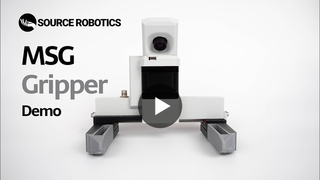

  

<h1 align="center">MSG gripper</h1>

  <b>Open-source compliant AI stepper gripper.</b> 
  Its closed-loop FOC stepper gives it real force control, and a camera looks between the jaws: made for teleoperation and robot learning.

  <a href="https://source-robotics.com/products/msg-gripper"><b>Buy</b></a>&nbsp;&nbsp;·&nbsp;&nbsp;
  <a href="https://docs.source-robotics.com/MSG-gripper-docs/"><b>Documentation</b></a>&nbsp;&nbsp;·&nbsp;&nbsp;
  <a href="https://docs.source-robotics.com/MSG-gripper-docs/latest/build/"><b>Build guide</b></a>&nbsp;&nbsp;·&nbsp;&nbsp;
  <a href="https://github.com/Source-Robotics/MSG-compliant-AI-stepper-gripper/releases/latest"><b>Download</b></a>&nbsp;&nbsp;·&nbsp;&nbsp;
  <a href="https://discord.com/invite/prjUvjmGpZ"><b>Discord</b></a>

  
  
  

| **55 to 155 mm** | **31 to 76 N** | **190 mm/s** | **380 g** | **24 V, CAN** |
|:-:|:-:|:-:|:-:|:-:|
| stroke, by rail length | ideal grip force, by stepper | jaw speed | 150 mm rail, 21.5 mm stepper | on one M8 cable |

## Project overview

<table>
  <tr>
    <td width="55%" valign="middle">
      The MSG compliant AI stepper gripper is built around
      <a href="https://source-robotics.com/products/stepfoc-stepper-controller">STEPFOC stepper drivers</a>, which
      enable precise FOC-based force control on standard stepper motors. This makes it well suited for assembly
      tasks, human-robot collaboration and AI data collection, including embodied AI, teleoperation and VLA
      training, thanks to its camera-friendly design. The gripper is modular in two ways: the rail length (100, 150
      or 200 mm) sets the maximum grip span, the stepper length (21.5, 40 or 60 mm) the maximum grip force. All
      mechanical files, firmware and software are open source, so you can attach a custom gripping tool and
      integrate the gripper with any robotic arm or platform. The gripper is still in beta: expect some bugs, from
      the hardware to the software.
        
      <a href="https://youtu.be/YUvNXfaHM6s"><b>&#9654;&#xFE0E;&nbsp; Watch the MSG gripper in action</b></a>
    </td>
    <td width="45%" valign="middle">
      
    </td>
  </tr>
</table>

## Start here

| I want to | Go to |
|---|---|
| **Buy an assembled gripper** | [source-robotics.com](https://source-robotics.com/products/msg-gripper), in the rail, stepper and colour you choose · [PAROL6 gripper cable](https://source-robotics.com/products/gripper-cable) |
| **Choose a rail and a stepper** | [Variants](https://docs.source-robotics.com/MSG-gripper-docs/latest/01-overview/variants/) · [specifications](https://docs.source-robotics.com/MSG-gripper-docs/latest/03-technical-data/specifications/) |
| **Build my own** | [BOM](BOM.md) · [STEP files](STEP%20files/) · [print files](Print%20files/) · [assembly video](https://youtu.be/EosuDy-heqM) · [cables and jaws](Assembly%20manual/) · [build guide](https://docs.source-robotics.com/MSG-gripper-docs/latest/build/) |
| **Set it up and make it move** | [Quick start](https://docs.source-robotics.com/MSG-gripper-docs/latest/quick-start/) · [Motor GUI](https://motorgui.com/) · [firmware (STEPFOC)](https://docs.source-robotics.com/MSG-gripper-docs/latest/08-firmware/) |
| **Program it** | [Python library](https://github.com/Source-Robotics/Spectral-BLDC-Python) ([first example](https://docs.source-robotics.com/MSG-gripper-docs/latest/guides/basic-control/)) · [ROS 2 driver](https://github.com/Source-Robotics/source_robotics_msg_gripper_ros2) ([original](https://github.com/BiomechatronicsLab/source_robotics_msg_gripper_ros2)) · [SSG-48 ROS 2 package](https://github.com/Lass6230/ssg48_adaptive_electric_gripper_ros2) (should work with the MSG too) · [CAN and UART reference](https://docs.source-robotics.com/MSG-gripper-docs/latest/reference/) |
| **Simulate it** | [URDF and MuJoCo models](msg_description/), standalone or on PAROL6 and PAR6 |
| **Put it on a robot** | [PAROL6 and PAR6](https://docs.source-robotics.com/MSG-gripper-docs/latest/06-operation/robots/) · [mounting on any robot](https://docs.source-robotics.com/MSG-gripper-docs/latest/04-installation/mounting/) |

## In this repository

| Folder or file | What is in it |
|---|---|
| [`STEP files`](STEP%20files/) | every part as STEP: `Common parts`, then the parts for your rail (100, 150 or 200 mm) and for your stepper (21.5, 40 or 60 mm), the jaw designs and the magnet tools |
| [`Print files`](Print%20files/) | the printed parts as 3MF projects: the body and the jaw carriers for each rail, the cover for each stepper, the common parts |
| [`BOM.md`](BOM.md) | the bill of materials, with links and reference images |
| [`Print_table.md`](Print_table.md) | the print setting: 25 % infill for every part |
| [`Assembly manual`](Assembly%20manual/) | how to build the cables and the gripper jaws; the assembly itself is a [video](https://youtu.be/EosuDy-heqM) |
| [`msg_description`](msg_description/) | the guide to the URDF and MuJoCo models, from [robot_descriptions](https://github.com/Source-Robotics/robot_descriptions) |
| [`Photos`](Photos/) | the reference images of the BOM and the assembly notes |

The [latest release](https://github.com/Source-Robotics/MSG-compliant-AI-stepper-gripper/releases/latest) has the print
files, the STEP files and the BOM as ready downloads. The gripper has no firmware of its own: it runs the firmware of
its STEPFOC driver, from [STEPFOC-stepper-controller](https://github.com/Source-Robotics/STEPFOC-stepper-controller).

## Community

Ask in [Discussions](https://github.com/orgs/Source-Robotics/discussions), chat on
[Discord](https://discord.com/invite/prjUvjmGpZ), report a bug in
[Issues](https://github.com/Source-Robotics/MSG-compliant-AI-stepper-gripper/issues), and follow Source Robotics:

## Safety, liability and disclaimer

This project includes experimental software, hardware designs, and assembly documentation that are still under
development and may contain bugs, errors, or incomplete features. By using, building, or modifying this project, you
acknowledge that:

* You use this project entirely at your own risk
* You are solely responsible for safe assembly, testing, and operation
* No guarantee is made regarding correctness, safety, or reliability
* The authors are not responsible for any damage, injury, or loss resulting from the use or misuse of this project
* Hardware performance and safety depend on user assembly, component quality, calibration, and handling, which cannot be guaranteed
* This project is provided “as is.” If you choose to build a device yourself using these files, designs, or instructions, you do so without any warranties or guarantees, including regarding safety, reliability, or suitability for any particular purpose.

> [!WARNING]
> THIS PROJECT INVOLVES LETHAL VOLTAGES AND OTHER SERIOUS HAZARDS THAT CAN CAUSE SEVERE INJURY. YOU MUST READ THE FULL [SAFETY WARNING AND DISCLAIMER DOCUMENT](SAFETY_WARNING_AND_DISCLAIMER.md)  BEFORE USING ANY PROJECT FILES. BY PROCEEDING, YOU ACKNOWLEDGE AND ACCEPT ALL RISKS AND AGREE TO USE THIS PROJECT ENTIRELY AT YOUR OWN RESPONSIBILITY.

## Licensing

Project is under [CERN Open Hardware Licence Version 2 - Strongly Reciprocal](https://github.com/Source-Robotics/MSG-compliant-AI-stepper-gripper?tab=CERN-OHL-S-2.0-1-ov-file)

## Versions

Which release and variant you have, and what works with it: [VERSIONS.md](VERSIONS.md).
